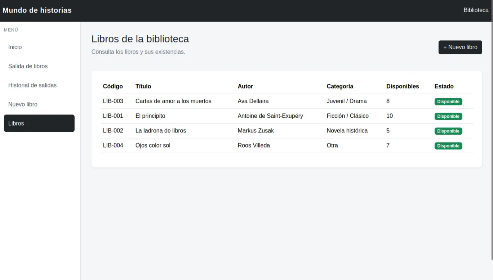
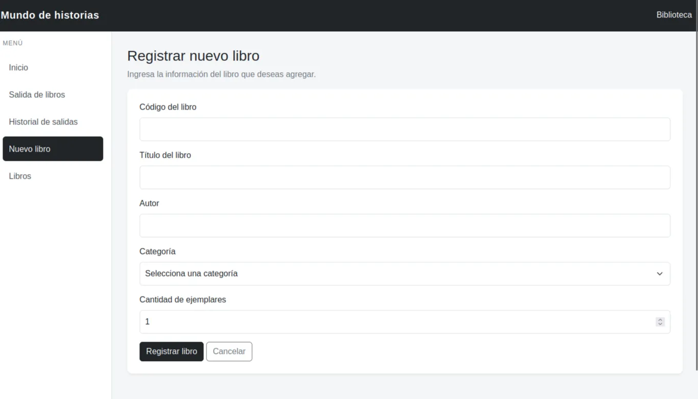
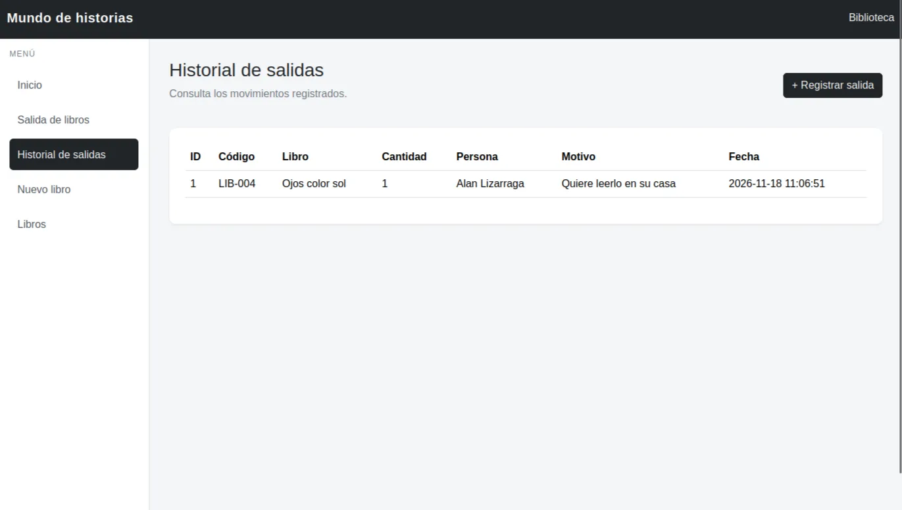

# Mundo de historias - Sistema de Gestión de Biblioteca

Aplicación web desarrollada en PHP, PDO y MySQL para el control de inventario de libros, registro de ejemplares y gestión de salidas o préstamos de la biblioteca.

## Equipo de Desarrollo
* **Valeria** (Scrum Master) - Base de datos y documentación (`main`)
* **Alan** (Product Owner) - Panel principal y catálogo (`rama-alan`)
* **Joshua** (Desarrollador) - Registro de libros y salidas (`rama-joshua`)
* **Dariana** (Desarrollador) - Formularios e historial de salidas (`rama-dariana`)

## Capturas de la Aplicación Web

### 1. Panel Principal (`index.php`)

### 2. Catálogo de Libros (`libros.php`)

### 3. Registrar Nuevo Libro (`nuevolibro.php`)

### 4. Registrar Salida de un Libro (`registrar_salida.php`)

### 5. Historial de Salidas (`reportes.php`)

